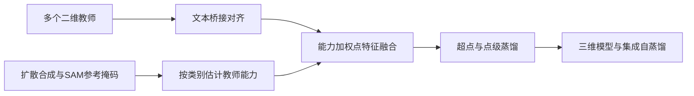

# SAS

## 资料范围与版本

阅读 arXiv:2503.08512 **v1（2025-03-11）** 正文及附录；正式来源为 ICCV 2025。以下数值对应 v1，不假定与会议最终版逐字一致。官方仓库仅做文档与目录核查，未运行。

## 任务

【原文事实】目标为开放词汇三维语义分割。离线准备使用多视角 RGB、相机参数、多个二维模型、扩散模型和 SAM；训练三维点网络，主实验报告纯三维模型推理结果。不要把离线多模型管线与部署时的纯三维推理成本混为一谈。

## 研究问题

一个二维教师对不同类别的识别能力并不相同，直接蒸馏会继承其错误。多个教师又可能处在不同嵌入空间，不能不经处理直接相加。SAS 分别处理“语义空间不一致”和“类别能力不一致”（§1、Fig.1–2）。

## 方法

1. **Model Alignment via Text（§3.1）。** 以 LSeg 与 SEEM 为例：SEEM 给区域和类别，TAP 补充描述，再用共享 CLIP 文本编码器编码描述并映回区域，使两教师可在共同空间内融合。文本桥接不是训练一个通用跨模型线性映射。
2. **Annotation-free Capability Construction（§3.2）。** 用扩散模型合成指定类别图像，以扩散注意力定位粗区域，再用 SAM 细化成参考掩码。比较教师掩码与参考掩码的 IoU，按类别形成能力表。参考本身是自动生成，**不是人工真值**。
3. **能力引导融合（§3.3，式(6)–(8)）。** 先由两教师特征得到点的候选类别，再从能力表取与候选类别有关的分数，温度归一化后加权特征。这里的“能力”不是直接读取每点预测 softmax 置信度。
4. **超点蒸馏（§3.4，式(10)）。** 聚合超点平均特征，组合点级与超点级余弦损失训练三维网络。超点语义一致性是方法假设，错误合并仍可能影响目标。
5. **Temporal Ensembling Self-Distillation（§3.4–3.5）。** 使用跨训练阶段的预测集成进行自蒸馏。此处 temporal 不能直接解释为“视频帧间记忆模块”。

## 实验 {#experiments}

【原文事实】§4.1 室内使用 LSeg+SEEM，室外使用 OpenSeg+SEEM。其 Table 1 报告 ScanNet v2 **61.9**、Matterport3D **48.6**、nuScenes **47.5 mIoU**。这些值属于所读 v1 的作者实验，不是本站复现结果。

更适合分析方法作用的是 Table 3 的 ScanNet 消融：

| 配置 | mIoU |
| --- | ---: |
| 直接相加融合二维特征 | 48.6 |
| 能力引导二维融合 | 55.5 |
| 点级蒸馏 | 56.7 |
| 超点蒸馏 | 59.2 |
| 超点蒸馏 + TESD | 61.9 |

该递进支持融合与蒸馏设计在该配置中有用，但不能把最终提升全部归给某一个模块。对比 OpenScene 时还需区分纯 3D 与 2D–3D ensemble、教师版本、词表和类别映射。

## 局限

【分析推断】合成图像上的类别能力未必与真实长尾场景一致；TAP 描述和自动参考掩码也会引入偏差。能力估计、特征准备和多模型环境增加离线成本。原文 §4.1 的类别数量表述需要结合附录与代码标签映射再核对，本站暂不据这一句建立跨论文协议组。

## 横向理解

与 OpenScene 相比，SAS 把“教师是否可靠”显式加入融合过程。与 GeoPurify 相比，前者主要增强语义来源，后者侧重语义特征进入三维后的几何一致性；两者作用位置不同，不能只按最终 mIoU 推断孰优。

## 开源情况

【官方文档说明】仓库包含 `MCC/`、`feat_fusion/`、`point_feat_extraction/`、`superpoint_extraction/`、模型与运行脚本，提供预处理特征入口。README 要求多个教师环境和外部检查点。本笔记没有确认这些流程端到端运行成功。

## 证据

| 主张 | 原始材料定位 |
| --- | --- |
| 文本桥接 | [v1 §3.1 / Fig.3](https://arxiv.org/html/2503.08512v1#S3.SS1) |
| 合成图像上的教师能力 | [§3.2 / Fig.4 / 式(3)–(5)](https://arxiv.org/html/2503.08512v1#S3.SS2) |
| 能力引导融合 | [§3.3 / 式(6)–(8)](https://arxiv.org/html/2503.08512v1#S3.SS3) |
| 主结果与消融 | [§4 / Table 1、3](https://arxiv.org/html/2503.08512v1#S4) |
| 代码公开范围 | [官方 README](https://github.com/peoplelu/SAS) |
